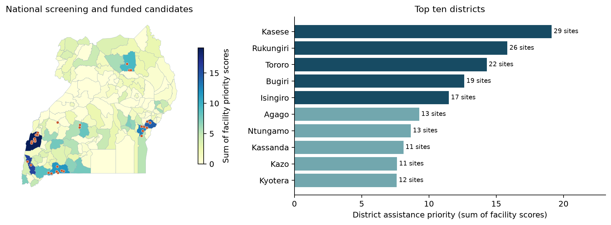

# Case Study 4: healthcare electrification in Uganda

A new assignment solution for a **USD 1,000,000** Ministry of Health programme. All geospatial evidence was downloaded directly from the live **Energy Access Explorer (EAE)** website's public catalogue and linked storage. No earlier local export, report, notebook or analysis output is an input.

## Start here

- [Four-page submission report](report/case_study_4_report.pdf)
- [Readable report text](report/case_study_4_report.md)
- [Explained calculation notebook](notebooks/healthcare_electrification.ipynb)
- [Native EAE export files](data/native_exports/README.md) - original PowerPoint, ANI GeoTIFF and CSVs, collected as supplemental evidence after the original analysis.
- [Full district ranking](outputs/district_ranking.csv)
- [Named conditional facility awards](outputs/funded_facilities.csv)
- [Budget by district](outputs/district_budget.csv)
- [Cost sensitivity](outputs/cost_sensitivity.csv)



## Findings

The source contains **4,938 facilities**. Screening public HC II/HC III facilities recorded without electricity, excluding two ERT-flagged records, yields **527 candidates across 104 districts**. Kasese, Rukungiri, Tororo, Bugiri and Isingiro rank highest under the documented facility-based assistance score.

The recommended conditional portfolio funds **32 critical-service upgrades in eight districts**, including seven remote facilities. It assigns USD 790,000 to installations, USD 50,000 to verification/design, USD 100,000 to five-year maintenance and USD 60,000 to contingency. Its nearest-facility catchments contain approximately **323,772 modelled potential beneficiaries**. This is a geographic model, not a verified patient count or number of households electrified.

The source health inventory is dated 2023. Current electricity status, full clinical load, funding overlap and site costs must be verified before awards. Planning packages do not guarantee full-facility electrification, particularly at larger HC IIIs.

## Reproduce offline

Python 3.12 was used. From the repository root:

```powershell
python -m venv .venv
.\.venv\Scripts\Activate.ps1
python -m pip install -r requirements.txt
python src/analyse.py
python src/make_figures.py
python src/build_report.py
python src/build_notebook.py --execute
python src/verify.py
```

The supplied raw snapshot is sufficient; analysis does not call any network service. An interactive notebook interface is optional: install JupyterLab separately with `python -m pip install jupyterlab`, then run `python -m jupyterlab`.

The saved PDF is exactly four pages. Report prose and its source date describe this snapshot; if raw data or policy inputs change, review the narrative and its assumptions before submission. The report builder intentionally checks the expected snapshot findings to prevent silently publishing stale prose.

## Method

1. Download current EAE metadata and original processed layers, recording URL, UTC retrieval time and SHA-256.
2. Join all facility coordinates to the 2024 district polygons, preserving polygon holes and islands.
3. Assign each positive WorldPop cell to its nearest facility among all 4,938 records, including private/electrified alternatives. Apply 3, 5 and 10 km centroid-distance limits; split co-located facilities' allocations equally. No population cell is counted twice.
4. Keep government HC II/HC III facilities whose electricity status and source both equal `No`, excluding ERT flags. Audit other records separately.
5. Score eligible facilities: **45% modelled catchment population, 25% prospective clinical energy, 20% distribution-distance gap and 10% relative poverty**. Population and energy use capped log scaling. District priorities sum eligible facility scores. Solar resource supports feasibility checks.
6. Reserve an award in each top-five district and at least USD 240,000 for remote candidates nationally; then fill by facility score, with at most ten awards per district. Compare price, weight, catchment and value-first scenarios.

`config.json` contains the explicit policy and cost assumptions. See [analysis implementation](src/analyse.py) and [source definitions](docs/sources.json).

## EAE website analysis versus the decision extension

The live website was also used for a district **Assistance Need Index** exploration. Its inputs, filters, weights and observed top ten are recorded in [the EAE session](docs/eae_session.json). After EAE sign-in, a matching [native export package](data/native_exports/README.md) was collected on 9 November 2026 as supplemental evidence. The native area index can prioritise places that do not contain eligible unserved public facilities; the independent facility screening therefore determines the proposed awards.

**The final district ranking is a transparent extension calculated from EAE data, not EAE's native district ANI.** The distinction is explicit in the report. The newly collected native export is preserved separately, with its original rankings, units and source-file cautions.

## Data provenance and cost evidence

- [Verified EAE source-download bundle](data/eae_source_downloads.zip) and [file-by-file guide](data/EAE_SOURCE_FILES.md).
- [Download manifest](data/download_manifest.jsonl): exact live URLs, UTC timestamps, content types and checksums.
- [Raw snapshot](data/raw/): national healthcare points, district polygons, population, distribution-distance, wealth and solar rasters, plus the live catalogue and layer definitions.
- [Endpoint-discovery provenance](docs/eae_discovery_resources.jsonl): URLs and checksums of website resources consulted to locate the public endpoints. Their application code is excluded from the repository because it is not an analysis input and can contain embedded service tokens.
- [Full EAE catalogue metadata](data/raw/uganda-datasets.json): original sources, data vintages, cautions and licences.
- [Attribution and references](docs/sources.json).
- [Snapshot checksums](outputs/source_checksums.csv).

EAE data were accessed on **8 November 2026 UTC**; the report date is **9 November 2026** in the user's South African time context. Retrieval time is separate from dataset vintage. Health is dated 2023, population 2022, wealth 2021, and boundaries/network 2024.

The sole external quantitative source is the [Uganda Ministry of Health HFSE announcement (31 July 2025)](https://health.go.ug/ministry-of-health-to-solarize-250-health-facilities-under-the-health-facility-solar-electrification-hfse-project/): USD 5 million for 250 facilities. USD 20,000 is a programme-average comparator. The HC III premium and remote uplift are stated assumptions, not sourced quotations.

To retrieve fresh files using the same official endpoints:

```powershell
python src/refresh_data.py
```

Refreshing changes the snapshot. Re-run the analysis and review the report before using updated recommendations.

## Files

```text
config.json                 Policy weights, budgets and cost assumptions
data/raw/                   Fresh EAE resources
data/download_manifest.jsonl Download provenance
docs/                       Source definitions and live website settings
src/                        Download, analysis, notebook, figures, report and checks
notebooks/                  Explained notebook
outputs/                    Audits, full ranking, named awards, scenarios and figures
report/                     Four-page PDF and Markdown
```

Original data-owner terms apply to third-party data. In particular, the wealth layer is CC BY-NC 4.0; complete attribution and licence text remain in the EAE catalogue. No blanket licence is applied to all source layers.
