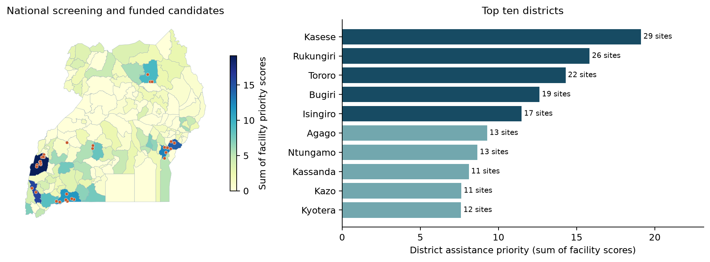

Powering primary care in Uganda

A USD 1 million healthcare electrification plan
Case Study 4 | 9 November 2026 | Fresh EAE data

## 1. Decision and health rationale

Fund **32 conditional critical-service upgrades** across eight districts. Prioritise Kasese, Rukungiri, Tororo, Bugiri and Isingiro, while reserving installation funds for remote facilities elsewhere. The plan allocates **USD 790,000 to installations, USD 50,000 to verification/design, USD 100,000 to five-year maintenance and USD 60,000 to contingency**. These are proposed awards, subject to current site and funding checks.

Electricity enables lighting, vaccine refrigeration, diagnostics, communication and water services. Interruptions can disrupt treatment and cold chains. The Ministry must balance the concentration of unserved facilities, people potentially served, clinical energy requirements and the higher delivery costs of remote locations. Electricity is one input: staffing, equipment and medicines also constrain outcomes. [3,4]

## 2. EAE evidence, filters and index choice

All geospatial inputs were downloaded afresh from the live EAE catalogue and its linked public storage on 8 November 2026 (UTC). The inventory contains **4,938 facilities**: 582 recorded without electricity and 130 with unavailable status. Retain government HC II/HC III facilities with both electricity fields equal to "No"; exclude two ERT-flagged records and retain **527 candidates in 104 districts**. Match points to the 146 EAE district polygons. These are historical records, not a 2026 field census. [1]

| EAE layer / vintage | Purpose and decision choice |

| --- | --- |

| Health facilities / 2023 | Public HC II/III, no electricity; use prospective daily kWh, not observed consumption. |

| WorldPop / 2022 | Allocate people to the nearest of ALL facilities, within 5 km; avoid overlap. |

| Distribution / 2024 | Greater distance indicates assistance need; retain remote sites, with no maximum-distance exclusion. |

| Relative wealth / 2021 | Lower RWI raises public-support priority; it is a relative asset proxy, not household income. |

| Solar GHI / 2024 | Check PV feasibility; annual averages do not determine seasonal battery adequacy. |

EAE website exploration used **Assistance Need Index**, district output, and importance 5/5/4/4/1 for health/population/distribution/wealth/GHI, with health proximity 0-5 km. The packaged export required login. Native area rankings can include already served urban facilities; marker visibility is not proof of a raster status filter. The final funding ranking therefore uses the auditable, facility-specific extension below, computed from the downloaded EAE data. It is **not labelled as EAE's native district ANI**. [1,2]

---

## 3. Reproducible healthcare priority ranking

**Facility score = 0.45P + 0.25E + 0.20D + 0.10W.** P is log(1 + allocated population), divided by log(1 + the candidate 95th percentile, 17,583.6 people). E applies the same transform to prospective daily energy, capped at the 95th percentile of 26.67 kWh/day. D is line distance/10 km; W = (2 - RWI)/4. Clip all components to [0,1]. Population and clinical services receive 70% together; infrastructure gaps receive 20%; wealth adds an equity signal. These weights are explicit policy choices.

Rank districts by the **sum of eligible facility scores**, representing the stock of candidate interventions. This favours districts with more unserved facilities; it is not a per-capita need rate. Ten candidates need median imputation for missing raster attributes; no funded facility does. Do not treat narrow score differences as precise clinical priorities.

| Rank | District | Eligible sites | Priority sum | Modelled people | Median line km |

| --- | --- | --- | --- | --- | --- |

| 1 | Kasese | 29 | 19.12 | 235,569 | 1 |

| 2 | Rukungiri | 26 | 15.83 | 124,786 | 0 |

| 3 | Tororo | 22 | 14.30 | 204,765 | 0 |

| 4 | Bugiri | 19 | 12.63 | 183,932 | 0 |

| 5 | Isingiro | 17 | 11.49 | 147,191 | 0 |

| 6 | Agago | 13 | 9.28 | 57,456 | 3 |

| 7 | Ntungamo | 13 | 8.66 | 142,748 | 0 |

| 8 | Kassanda | 11 | 8.11 | 116,419 | 3 |

| 9 | Kazo | 11 | 7.63 | 88,519 | 0 |

| 10 | Kyotera | 12 | 7.61 | 68,839 | 1 |

**Kasese** leads with 29 candidates and about 235,569 modelled catchment residents; its larger unserved service footprint dominates the district score.

**Rukungiri** has 26 candidates and about 124,786 modelled residents; low wealth and numerous unserved facilities support priority even near distribution infrastructure.

**Tororo** combines 22 candidates with about 204,765 modelled residents and comparatively strong GHI, supporting the concentration of prospective demand.

**Bugiri** has 19 candidates and about 183,932 modelled residents; high modelled catchment demand drives priority despite short line-proximity values.

**Isingiro** has 17 candidates, about 147,191 modelled residents and the lowest mean RWI of the top five; it also includes a more distant candidate.

A recorded distance of 0 km means the same coarse grid vicinity, not a verified connection. Near-line facilities can still be unelectrified because of connection charges, last-mile works or missing equipment; the data do not establish which barrier applies. EAE reports prospective energy demand, not patient volumes or avoided mortality.

---

## 4. Budget, facility selection and people potentially reached

The official Ministry HFSE announcement reports USD 5 million for 250 facilities: a **USD 20,000 programme-average comparator**. Its detailed scope and unit prices are unavailable. Assume USD 20,000 per HC II critical-service system, USD 40,000 per HC III, and a 25% logistics uplift where line proximity exceeds 5 km. The HC III premium and remote uplift are analyst assumptions, not quoted prices. [4]

Reserve one candidate in each top-five district; allocate at least USD 240,000 (30% of the USD 800,000 installation ceiling) to remote candidates nationally. Then fill by descending facility score within the top five, followed by remaining districts if funds permit. Cap each district at ten facilities. This transparent heuristic is not a mathematical health-outcome optimum. Remote reservation adds Agago, Kassanda and Kyenjojo to the main five.

| District | Facilities | Installation USD | Modelled people | USD/person* |

| --- | --- | --- | --- | --- |

| Agago | 3 | 125,000 | 19,031 | 6.57 |

| Bugiri | 4 | 80,000 | 39,595 | 2.02 |

| Isingiro | 7 | 165,000 | 67,703 | 2.44 |

| Kasese | 10 | 200,000 | 116,293 | 1.72 |

| Kassanda | 2 | 50,000 | 17,966 | 2.78 |

| Kyenjojo | 1 | 50,000 | 14,970 | 3.34 |

| Rukungiri | 2 | 40,000 | 17,802 | 2.25 |

| Tororo | 3 | 80,000 | 30,412 | 2.63 |

| Funding item | USD |

| --- | --- |

| Installed critical-service systems (27 HC II, 5 HC III) | 790,000 |

| Verification, design and duplicate-funding checks | 50,000 |

| Five-year maintenance reserve | 100,000 |

| Contingency and unused installation balance | 60,000 |

| TOTAL | 1,000,000 |

*Installation cost per modelled catchment resident; audit, maintenance and contingency are excluded from district unit ratios. Seven remote facilities receive USD 250,000. Maintenance averages USD 625 per funded facility per year for five years; bids must validate this allowance and identify battery-replacement funding.

## Population estimate and technical scope

The funded locations have **323,772 modelled potential beneficiaries**, equivalent to USD 3.09 per person using the entire budget. Assign each positive WorldPop cell inside Uganda to its nearest facility among all 4,938 records, within 5 km of its centre; co-located facilities share their assigned population. This produces disjoint modelled populations. The source Catch_pop field repeats service-level planning standards, so it is not summed as unique people.

These residents are not verified patients or newly connected households. Service choice, terrain, referrals and new facilities can change the estimate. Fund **critical circuits**, with clinical staff defining protected loads. Two selected HC IIIs have prospective full-facility demand above 130 kWh/day; their planning packages cannot be assumed to meet full demand. Require site-specific load measurements, seasonal PV/storage design and priced bids before approving their scope.

---

## 5. Sensitivity and the equity/value trade-off

Re-run the same selection rules at changed installation prices, retaining USD 50,000 for audits, USD 100,000 for maintenance and at least USD 50,000 contingency. Lower prices expand the programme; higher prices reduce awards. Contingency remains protected in these scenarios rather than automatically financing inflation.

| Price change | Facilities | Installation USD | Modelled people | Contingency USD |

| --- | --- | --- | --- | --- |

| -20% | 42 | 800,000 | 425,922 | 50,000 |

| +0% | 32 | 790,000 | 323,772 | 60,000 |

| +20% | 26 | 798,000 | 266,006 | 52,000 |

| +40% | 22 | 777,000 | 230,026 | 73,000 |

Population-heavy weights (65/15/10/10) and equity-heavy weights (25/15/40/20) retain the same top five districts. This demonstrates stability to these tested preferences, not all possible choices. Changing the catchment radius from 5 km to 3 or 10 km changes the baseline funded sites' potential population from 323,772 to 246,627 or 348,521; this is a catchment sensitivity, without re-optimising site selection.

Under the same budget and district-cap rules, prioritising people per dollar and dropping the remote reserve funds **40 sites and 475,246 modelled residents, with no remote sites**. The recommended plan funds 32 sites and 323,772 residents, including seven remote sites. Agago costs USD 6.57 per modelled resident in installation spending, versus Kasese USD 1.72. The equity plan accepts that difference to reach remote service locations; cost per resident is not cost per health outcome.

## 6. Limits and Ministry next steps

**Validate eligibility first:** the health layer is dated 2023; new connections and the HFSE programme can make its status obsolete. Reconcile named sites and unique IDs with district teams, ERT and current donor awards. Missing-status facilities and unreliable on-grid/off-grid facilities were not ranked as unserved; survey them separately. The five selected HC IIIs need particular scrutiny of load scope and costs.

**Validate benefit and supply:** 1 km rasters and straight-line catchments do not represent walking times or service-specific access. Population (2022), wealth (2021), boundaries and network data (2024) have different vintages. Distribution data include some under-construction segments, so proximity can overstate current supply. Annual GHI at funded sites ranges about 1,517-2,192 kWh/m2; test seasonal yield, shading, network capacity and outage history. Require competitive quotes, maintenance responsibilities and commissioning tests before releasing installation funds. Monitor power-related service interruptions and repair response; do not infer deaths averted from this screening model.

## Sources and reproducibility

[1] EAE Uganda live catalogue and linked storage: MoH/WRI health (2023), UBOS districts (2024), WorldPop population (2022), Meta RWI (2021), ESGWG distribution (2024), WBG/ESMAP/Solargis GHI. Accessed 8 Nov 2026 UTC. Exact URLs, metadata, licences, timestamps and SHA-256 hashes: data/download_manifest.jsonl and docs/sources.json. All calculations: src/analyse.py; full 104-district ranking and named awards: outputs/.

[2] Mentis et al. 2019. <a href="https://www.wri.org/research/energy-access-explorer-data-and-methods" color="#237d81">Energy Access Explorer: Data and Methods</a>. [3] Sinclair-Lecaros et al. 2023. <a href="https://www.wri.org/research/gis-assessment-electricity-health-care-uganda" color="#237d81">A GIS-Based Demand Assessment Methodology ... Uganda</a>. These explain the EAE framework and prospective demand approach; final weights and award rules are analyst choices.

[4] Uganda Ministry of Health, 31 Jul 2025. <a href="https://health.go.ug/ministry-of-health-to-solarize-250-health-facilities-under-the-health-facility-solar-electrification-hfse-project/" color="#237d81">Health Facility Solar Electrification project announcement</a>. USD 5 million / 250 facilities supplies the cost comparator. An announcement is not completion evidence. This is the sole external quantitative source beyond EAE; no earlier local analysis or exports were used.
